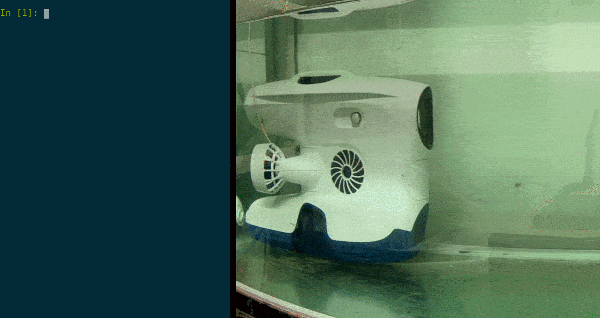

# blueye.sdk
[](https://github.com/BluEye-Robotics/blueye.sdk/actions)
[](https://github.com/ambv/black)
[](https://codecov.io/gh/BluEye-Robotics/blueye.sdk)
[](https://pypi.org/project/blueye.sdk/)
[](https://pypi.org/project/blueye.sdk/)
_________________

[Read Latest Documentation](https://blueye-robotics.github.io/blueye.sdk/) - [Browse GitHub Code Repository](https://github.com/BluEye-Robotics/blueye.sdk)
_________________

A Python package for controlling Blueye underwater drones from a computer. It drives the drone and its auto modes, reads telemetry, records video and takes pictures, runs missions, controls guest port tools such as grippers and lights, and downloads dive logs. It also installs a `blueye` command for common tasks from the terminal.



## Installation
The SDK needs Python 3.10 or newer.

```shell
pip install blueye.sdk
```

Two extras add optional dependencies:

- `pip install "blueye.sdk[examples]"` for the example scripts.
- `pip install "blueye.sdk[cli]"` for the CLI commands that bundle computer vision models and convert dive logs to MCAP.

[uv](https://github.com/astral-sh/uv) works too, with `uv pip install blueye.sdk`. The [Quick Start Guide](https://blueye-robotics.github.io/blueye.sdk/latest/quick_start/) walks through setting up a virtual environment on Windows, macOS and Linux.

## A first script
With your computer on the surface unit's Wi-Fi, this connects as an observer, so the pilot keeps control, and prints the depth and battery level:

```python
from blueye.sdk import Drone

with Drone(connect_as_observer=True) as drone:
    print("Depth in metres:", drone.get_depth())
    print("Battery level, 0 to 1:", drone.battery.get_state_of_charge())
```

## Supported drones
The SDK works with every Blueye model: the Pioneer, Pro, X1, X3, X3 Ultra and X7.

| Model | Camera | Camera tilt | Guest ports | CV models |
| --- | --- | --- | --- | --- |
| Pioneer | Up to 1080p | None | None | No |
| Pro | Up to 1080p | ±30° | None | No |
| X1 | Up to 1080p | ±30° | 1 | No |
| X3 | Up to 1080p | ±30° | 3 | No |
| X3 Ultra | 4K | ±30° | 3 | Yes |
| X7 | 4K | ±90° | 6 | Yes |

[Blueye drone models](https://blueye-robotics.github.io/blueye.sdk/latest/models/) has the full table and the differences that matter to a script, and [blueyerobotics.com](https://www.blueyerobotics.com/products) has more about the drones.

## Documentation
The [documentation](https://blueye-robotics.github.io/blueye.sdk/) covers connecting, movement, video, logs, configuration, telemetry, peripherals and missions, with a full API reference.

The surface unit's Wi-Fi usually has no internet access, so a copy of the documentation for the installed version ships with the package. Open it with:

```python
import blueye.sdk

blueye.sdk.open_local_documentation()
```

Run `blueye --help` for the CLI. Report bugs and ask questions on [GitHub Issues](https://github.com/BluEye-Robotics/blueye.sdk/issues).
