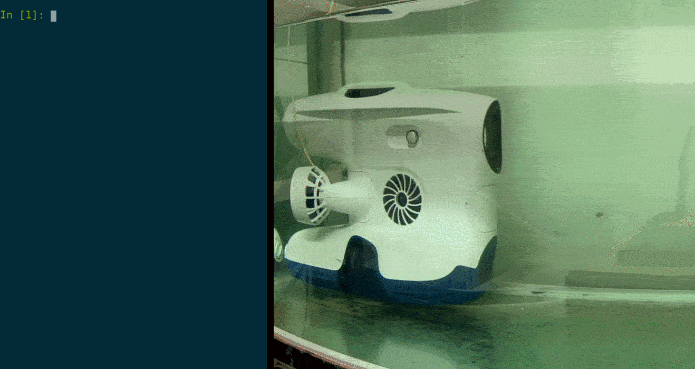

Blueye makes the Pioneer, Pro, X1, X3, X3 Ultra and X7 underwater drones, and the SDK works with all of them. The Pioneer and Pro are built for inspection. The other models have guest ports for tools such as grippers, sonars and positioning systems, and the X3 Ultra and X7 add a 4K camera and can run computer vision models on the drone.

| Model | Camera | Camera tilt | Guest ports | CV models |
| --- | --- | --- | --- | --- |
| Pioneer | Up to 1080p | None | None | No |
| Pro | Up to 1080p | ±30° | None | No |
| X1 | Up to 1080p | ±30° | 1 | No |
| X3 | Up to 1080p | ±30° | 3 | No |
| X3 Ultra | 4K | ±30° | 3 | Yes |
| X7 | 4K | ±90° | 6 | Yes |

See [Blueye drone models](models.md) for the differences that matter to a script, and [blueyerobotics.com](https://www.blueyerobotics.com/products) for more about the drones.

## This SDK and the Blueye drones
A Blueye drone is normally controlled via a mobile device through the Blueye App ([iOS](https://apps.apple.com/no/app/blueye/id1369714041)/[Android](https://play.google.com/store/apps/details?id=no.blueye.blueyeapp)).
The mobile device is connected via Wi-Fi to a surface unit, and the drone is connected to the surface unit via a tether cable.

This python SDK exposes the functionality of the Blueye app through a Python object. The SDK enables remote control of a Blueye drone as well as reading telemetry data and viewing video streams. It is not meant for executing code on the drone itself.

To control the drone you connect your laptop to the surface unit Wi-Fi and run code that interfaces with the through the Python object.

Check out the [`Quick Start Guide`](quick_start.md) to get started with using the SDK.
